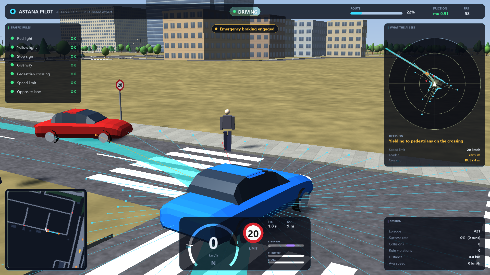
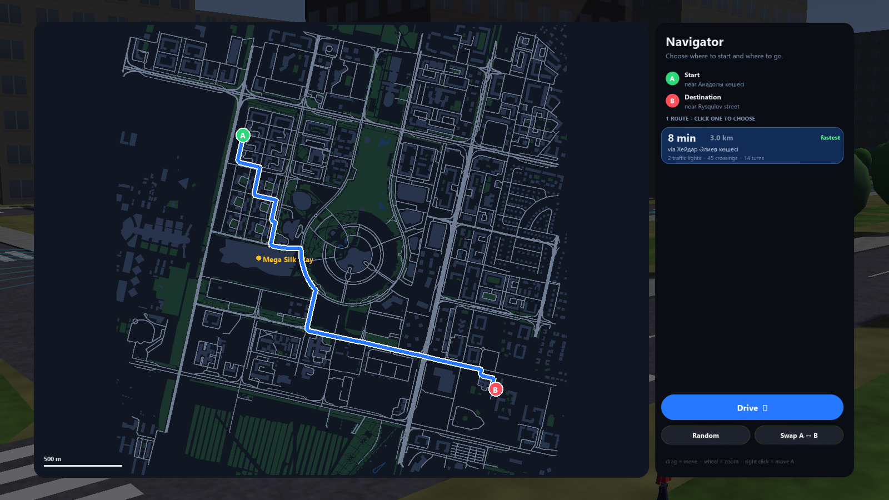
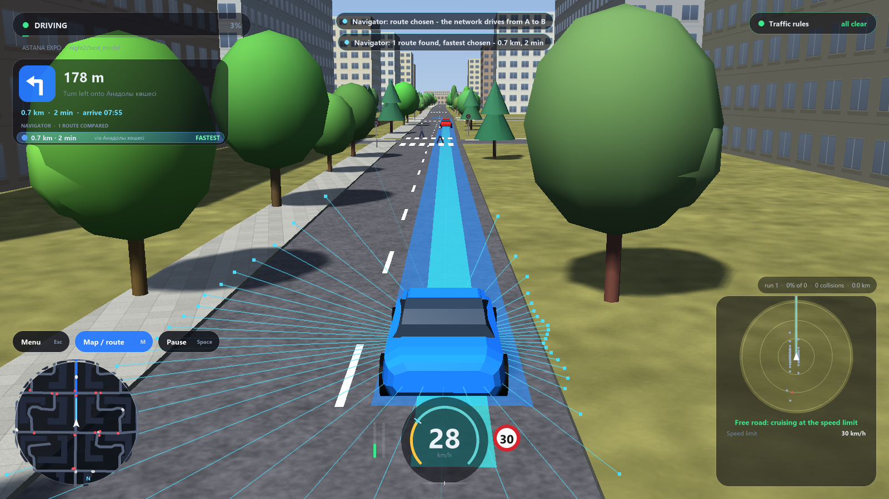
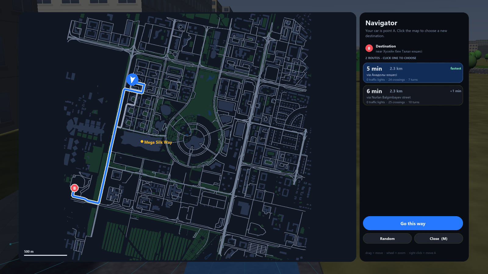
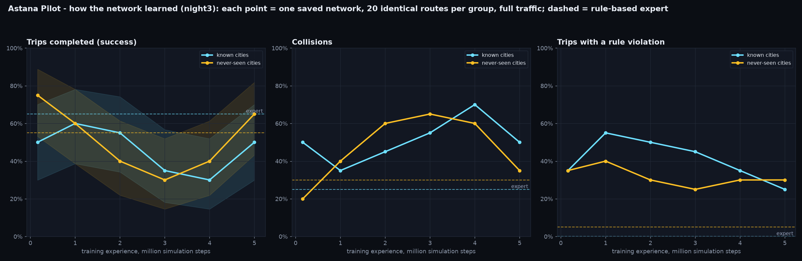
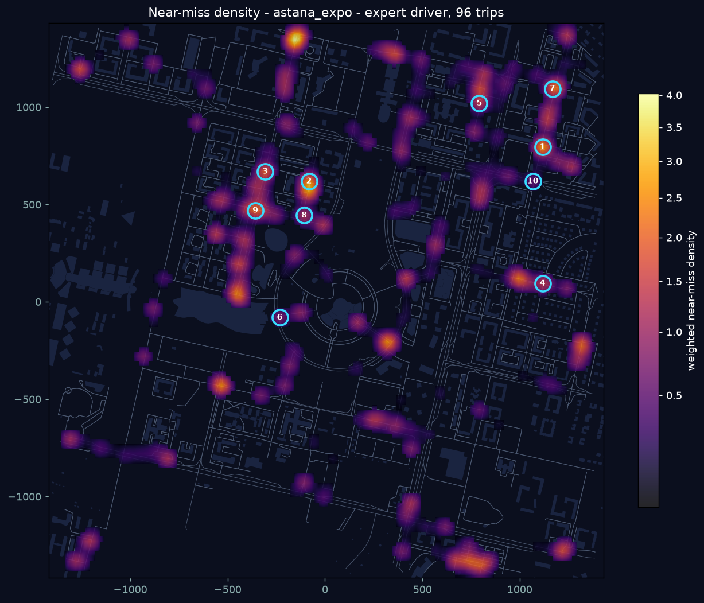

<h1 align="center">🏙️ Astana Pilot</h1>
<p align="center"><b>A digital twin of Astana for road-safety audit and for testing AI autopilots</b><br/>
<sub>OpenStreetMap ➜ multi-level 3-D city ➜ a neural-network driver trained on one laptop GPU ➜ a map of the most dangerous places</sub></p>

<p align="center">
  
  
  
  
  
</p>

<p align="center">
  
</p>

> **In one sentence.** Pick any two points on a real map of Astana. A classical navigator plans the route; a neural network that has
> **never seen the map** drives it through traffic, pedestrians and traffic lights. Every collision, every rule violation and every
> needless stop is counted, and the same simulation tells city engineers where their streets produce the most near-misses.

---

## 📑 Contents
[✨ Highlights](#-highlights) · [🎬 Demo](#-demo-choose-a-and-b-the-network-drives) · [📊 Results](#-results-network-vs-expert) ·
[🚀 Quick start](#-quick-start) · [🧠 How the driver learns](#-how-the-driver-learns) · [🛡️ Road-safety audit](#%EF%B8%8F-road-safety-audit) ·
[🔬 Evaluation protocol](#-evaluation-protocol) · [🏗️ Architecture](#%EF%B8%8F-architecture) · [⚠️ Limitations](#%EF%B8%8F-limitations) ·
[🗺️ Roadmap](#%EF%B8%8F-roadmap) · [🤝 Transparency](#-development-transparency)

## ✨ Highlights

| | |
|---|---|
| 🗺️ **Any district in one command** | `astana map --preset expo` downloads OpenStreetMap and builds a 3-D city with **flyovers, ramps and tunnels** — each road level gets its own collision field. Tested on Astana EXPO (ring roads, Nur Alem) and the Nurzhol government quarter (Ishim flyovers). |
| 🧭 **Point-to-point navigation** | Click A and B on the map; the navigator compares up to 3 alternative routes (penalty method, ETA from speed limits, curves and expected waits at signals) and picks the fastest. Change the destination **while driving** — the route is re-planned from where the car is. |
| 🤖 **A driver that does not memorise** | The network observes 351 numbers: lidar (48 rays, object type, closing speed), its own speed, the next ~32 m of the route, the next signal / sign / crossing, speed limit, road level and the 8 nearest road users. **No absolute coordinates** — generalisation to unseen cities is tested, not assumed. |
| 🚦 **Rule-first metrics** | Red / yellow light, stop sign, give-way, zebra, speeding and opposite-lane use are counted separately; standing still is classified as *justified* or *needless* (phantom braking). |
| 🛡️ **Road-safety audit** | The agent becomes a probe: emergency brakes, time-to-collision < 1.5 s, hard braking and close pedestrian passes are mapped to GPS hot-spots and ranked per km driven; *what-if* variants (speed limit × 0.8, longer green) are compared on identical trips. |
| 💻 **Laptop-sized** | Pure Python (PyTorch, Stable-Baselines3, Ursina). Trained overnight on an RTX 4060 Laptop GPU. No Unreal, no HD maps. |

## 🎬 Demo: choose A and B, the network drives

```bat
scripts\demo_navigator.bat expo          :: or in the Studio: "Start 3D simulation" → Map (M)
```

| 1️⃣ Click A and B, compare the routes | 2️⃣ The network drives (route line, manoeuvre card, rule board) | 3️⃣ New destination while driving |
|---|---|---|
|  |  |  |

On-screen buttons **Menu · Map / route · Pause**; after every trip the viewer stops and shows the result (distance, time, violations) with
*next destination / same trip again / random route*. `Esc` opens the menu (camera, weather, simulation speed, manual driving, exit).

**Two layers, as in a real autonomous car:** the *navigator* (Dijkstra with alternatives on the OSM graph) knows the map and chooses the
route; the *neural network* knows nothing about the map and only steers and brakes along the next metres of that route.

## 📊 Results: network vs expert

Protocol: **the same 30 random A→B trips per city group for every driver** (paired seeds never used in training), full traffic
(difficulty 1.0), 95 % Wilson intervals. *Seen* = the four cities of training (real EXPO, real Nurzhol, 2 synthetic); *unseen* = four
synthetic cities with a different layout that the network never drove in. The *expert* is a hand-written rule-based driver (the network's teacher).

| | 🤖 **Network** (`demo_weights/astana_pilot.zip`) | 📐 **Rule-based expert** |
|---|---|---|
| ✅ Trips completed — seen cities | **56.7 %** [39–73] | 60.0 % [42–75] |
| ✅ Trips completed — unseen cities | **53.3 %** [36–70] | 56.7 % [39–73] |
| 🧠 Seen → unseen change (memorisation check) | **−3.3 pp** | −3.3 pp |
| 💥 Collisions (seen / unseen) | 36.7 % / 46.7 % | 30.0 % / 30.0 % |
| 🚦 Trips with a rule violation (seen / unseen) | 36.7 % / 23.3 % | 0.0 % / 3.3 % |
| 🔴 Red-light crossings per trip (seen / unseen) | 0.33 / 0.20 | 0.00 / 0.03 |
| 🐢 Needless slow driving, share of time | 16.8 % / 12.9 % | 15.4 % / 9.7 % |
| 📏 Share of the route driven | 70.7 % / 71.8 % | 78.4 % / 76.3 % |

**Reading it honestly**

* ✅ On **completing trips the network is statistically on par with its teacher** (55 % vs 58 % overall; the intervals overlap), and it loses
  exactly as much as the expert when moved to unseen cities — no sign of a memorised map.
* 🚦 **Rule compliance is the open problem.** The expert almost never violates a rule; the network crosses on red in roughly every fourth
  trip. Fine-tuning with violation penalties × 2.5 (run `night3`) reduced violation trips on unseen cities from 36.7 % to 23.3 % but not on
  the seen ones — see [what we learned](#-how-the-driver-learns).
* 🎯 Neither driver reaches 100 %: trips are hard on purpose (dense traffic, jay-walking pedestrians, parked cars blocking the lane,
  random road friction, narrow real courtyards). *Any* kerb touch, 8 s of unjustified standing or leaving the route counts as a failure.
* 📉 30 trips per group give ±15–18 pp intervals. Reproduce or tighten them with `astana eval --episodes 100 …` (command below).

<p align="center"><br/>
<sub>Every saved network of the fine-tuning run on the same 20 routes per group (<code>astana progress night3</code>); dashed = expert, shaded = 95 % interval.
As the curriculum raised traffic to full density (≈ 2–4 M steps) performance dipped, then recovered by 5 M; the share of trips with a violation in
the known cities fell from 55 % to 25 %. With 20 routes per point the intervals are wide — the trend, not single points, is the message.</sub></p>

## 🚀 Quick start

**Requirements:** Windows 10/11 (Linux/macOS work with the same commands), Python 3.10–3.12, optional NVIDIA GPU for training.

```bat
:: 1. one-time setup: creates .venv, installs everything incl. the CUDA build of PyTorch
scripts\setup_windows.bat
.venv\Scripts\activate

:: 2. self-test of the whole stack, ~1 minute
astana check

:: 3. build the real districts (offline, from the OpenStreetMap answers cached in assets/osm_cache, ~20-60 s each)
astana map --preset expo
astana map --preset nurzhol
```

| 🎯 What | Command |
|---|---|
| 🖥️ **Studio** — one window with buttons for everything | `astana` |
| 🧭 Choose A and B on the map, the network drives | `astana view --map assets\maps\astana_expo.pkl --model demo_weights\astana_pilot.zip --pick` |
| 🎲 Random verified route every trip | `astana view --map assets\maps\astana_nurzhol.pkl --model demo_weights\astana_pilot.zip --random-route --verified` |
| 📍 A → B by name | `astana view --map assets\maps\astana_nurzhol.pkl --model demo_weights\astana_pilot.zip --start-node Bayterek --goal-node Turkistan` |
| 📐 Watch the rule-based expert instead | `astana view --map assets\maps\astana_expo.pkl --pick` |
| 📊 **Evaluate** network vs expert, seen vs unseen | `astana eval --model demo_weights\astana_pilot.zip --episodes 60 --seen-maps assets\maps\astana_expo.pkl,assets\maps\astana_nurzhol.pkl,synthetic:0,synthetic:1 --unseen-maps synthetic:100,synthetic:101,synthetic:102,synthetic:103` |
| 🛡️ Road-safety audit with what-if variants | `astana audit --map assets\maps\astana_expo.pkl --episodes 300 --variants "baseline;limit0.8;green30"` |
| 🌙 Train overnight (BC → DAgger → PPO, resumable) | `scripts\run_night.bat 8 night1` |
| 🔁 Fine-tune an existing network | `scripts\run_finetune.bat 8 night3 demo_weights\astana_pilot.zip` |
| 📈 Training curves / progress of every checkpoint | `astana plot night1 --watch` · `astana progress night1` |
| 🎥 Record a video | `astana record --map assets\maps\astana_expo.pkl --duration 90 --out assets\videos\demo.mp4` |

**Viewer keys:** `M` map / change route · `Esc` menu · `Space` pause · `C`/`1–8` cameras · `T` day/dusk/night/snow · `L` lidar · `H` HUD ·
`G` drive yourself (WASD) · `+`/`-` simulation speed · `F12` screenshot · `V` video.

## 🧠 How the driver learns

```text
 rule-based expert ──► demonstrations ──► Behaviour Cloning ──► critic warm-up ──► DAgger ──► PPO (adaptive curriculum) ──► fine-tuning
      (teacher)          (300 trips)      (copies the expert)   (learns values)   (student      (learns from its own        (violation
                                                                                    drives,       mistakes; reward:          penalties
                                                                                    expert        progress, finish, −crash,  × 2.5)
                                                                                    corrects)     −violation, −needless stop)
```

* **Why not only behaviour cloning?** A cloned policy only knows states the expert visited; one small error leads it somewhere new and errors
  compound. It also copies the expert's own mistakes. PPO optimises the *outcome* on the network's own trajectories.
* **Why not only PPO?** From scratch it needs far more experience than a laptop has overnight; cloning gives a driver that already moves.
* **What went wrong and how it was found** (details in [`docs/TRAINING_NOTES.md`](docs/TRAINING_NOTES.md)):
  the first overnight run ended at 0 % success because the first PPO updates destroyed the cloned policy. Fixes: tiny exploration noise for a
  cloned policy, the actor frozen while the critic warms up, KL-adaptive learning rate and automatic roll-back to the best weights.
* **Fine-tuning for the rules (run `night3`).** The first network crossed on red in 37 % of trips. Violation penalties were raised × 2.5 and
  the network was fine-tuned for 5.1 M steps (6.4 h). Violation trips during training dropped from 23 % to 8 % within half an hour, but once the
  curriculum reached full traffic the success rate collapsed and the stability guard rolled back six times; the selected network is from 0.88 M
  steps. Lesson: a one-off violation penalty is weak next to a collision that ends the trip — next step is a red-light crossing that ends the
  trip (as in a driving test) and a slower curriculum.

Network: circular 1-D convolution over the lidar rays + MLP 256 × 256 — **≈ 0.55 M parameters** in the driving (actor) part; separate critic of
the same size. Actions: steering and pedal (throttle / brake / reverse). A measured emergency-brake layer sits underneath (`AEB time` in the table).

## 🛡️ Road-safety audit

```bat
astana audit --map assets\maps\astana_expo.pkl --episodes 300 --variants "baseline;limit0.8;green30"
```

<p align="center"></p>

Crashes are rare and every one has a victim, so traffic engineering studies **surrogate safety measures** — near-misses that appear long
before crashes. The audit lets the agent drive hundreds of random trips and records each emergency brake, time-to-collision < 1.5 s, hard
braking, pedestrian passed closer than 1.2 m and rule violation with its position. Output in `reports/audit_<map>/`: a heat-map, a ranked list
of hot-spots with the nearest street (`hotspots.csv`, `hotspots.geojson` for QGIS / Google Earth) and a comparison of infrastructure variants
on **identical trips** with bootstrap intervals.

It is a **screening tool**: it tells an engineer *where to look first* and quantifies trade-offs (safety events vs trip time). It does not
predict crash counts and has not yet been validated against real crash locations — see [`docs/IMPACT.md`](docs/IMPACT.md).

## 🔬 Evaluation protocol

* **Paired seeds:** the network and the expert drive exactly the same trips (route, traffic, pedestrians, friction) — evaluation seeds ≥ 10 000 000
  are never used in training.
* **Seen vs unseen cities** with Wilson intervals; a drop of more than ~10 pp would indicate a memorised map.
* **Outcome breakdown:** success / collision (by kind: wall, parked car, car, bus, pedestrian) / stall / lost / time-out.
* **Rules and manners:** violations per rule, opposite-lane share, speeding share, needless slowness, emergency-brake reliance, steering jerk.
* **Progress chart:** every saved checkpoint on the same routes (`astana progress <run>`), so learning is shown as a controlled experiment, not a noisy training curve.

## 🏗️ Architecture

```text
OpenStreetMap ─► tools/overpass + osm_builder ─► RawMap ─► CityMap (graph + one signed-distance field per road level)
                                                              │
   env/navigator (A→B, alternatives, ETA, turn-by-turn) ──────┤
                                                              ▼
        ┌────────────────────────── env/ (Gymnasium) ────────────────────────────────┐
        │ route (lane path, speed profile) ▸ infrastructure (signals, zebras, signs)   │
        │ world (IDM cars, buses, pedestrians) ▸ perception (351-D, no coordinates)    │
        │ rules monitor ▸ emergency brake ▸ reward                                     │
        └──────────────┬────────────────────────────────────────────┬───────────────┘
                       │                                            │
     training/ (BC → DAgger → PPO, curriculum, eval, progress)   audit/ (near-misses → hot-spots → what-if)
                       │                                            │
                       └──────────► viz/ (Ursina 3-D twin · navigator map · HUD · menus · 2-D viewer · video) ◄──┘
```

```text
astana_pilot/  env/ agents/ training/ audit/ tools/ viz/ studio/
demo_weights/  the published network          docs/  architecture, impact, results, training notes, runbook (RU)
assets/        OSM cache (maps rebuild offline), map metadata      scripts/  one-click .bat files      tests/  99 tests
```

Details: [`docs/ARCHITECTURE.md`](docs/ARCHITECTURE.md) · measurements: [`docs/RESULTS.md`](docs/RESULTS.md) · step-by-step guide (Russian): [`docs/RUNBOOK_RU.md`](docs/RUNBOOK_RU.md)

```bat
pytest            :: 99 tests, no GPU and no network needed
astana check      :: torch / CUDA / SB3 / BC / PPO / save-load smoke test on your machine
```

## ⚠️ Limitations

* 🚦 **The network still violates rules** (red light in ~ every fourth trip) — the expert does not. This is the main open problem.
* 🌍 The world is a **model**: kinematic car, IDM drivers, scripted pedestrians, idealised lidar without noise; no cameras, cyclists or
  scooters. Not a vehicle controller; sim-to-real is future work.
* 🗺️ No *real* unseen district in the test yet: both Astana districts were used in training; unseen cities are synthetic.
* 🐢 Some stops look unjustified to a viewer. Part of them are reactions to things outside the camera view (a light around a bend, a
  pedestrian predicted to step out); part are real over-caution, measured as *needless slow* — one known cause is that the reward does not
  penalise slowness within 40 m of any traffic control, even on green.
* 🚗 Right-hand traffic only (Kazakhstan). Left-hand traffic (Hong Kong) is on the roadmap.
* 📍 The audit ranks *relative* risk for a simulated careful driver and is not yet validated against real crash data.
* 🧾 OSM quality varies: lane counts are estimated when untagged; only ~35 % (Nurzhol) to ~60 % (EXPO) of random node pairs give a
  drivable route (sharp OSM corners, kerbs); the navigator snaps A and B to the nearest drivable road.

## 🗺️ Roadmap

1. 🚦 Red-light crossing ends the trip; slower curriculum; reward fix for slowness near green lights.
2. 🇭🇰 Left-hand traffic and Hong Kong districts (flyover- and tunnel-rich) — the map tool already fetches any place.
3. 🧪 Leave-one-district-out test on a real district (train without Nurzhol, test on it).
4. 📊 Validate audit hot-spots against police crash statistics with a city road-safety unit.
5. 🚲 Cyclists and scooters; winter friction; camera perception front-end.

## 🤝 Development transparency

This project was developed with an AI coding assistant. The author set the problem and the requirements, chose the districts and the
evaluation protocol, ran the training and the experiments, decided what to change from the measurements (e.g. raising violation penalties
after measuring 37 % violation trips) and decides what is claimed; the assistant wrote most of the code under that direction. Every number in
this README was produced by the commands shown here and can be reproduced.

## 📄 License and data

Code: MIT ([LICENSE](LICENSE)). Map data © OpenStreetMap contributors, ODbL ([`assets/osm_cache/README.md`](assets/osm_cache/README.md)).

<p align="center"><sub>Made in Astana 🇰🇿 · built on a laptop · measured honestly</sub></p>
